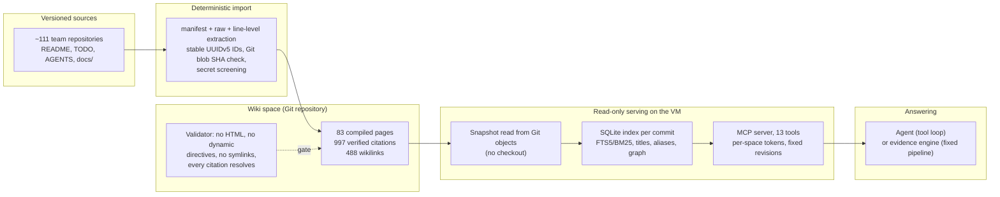
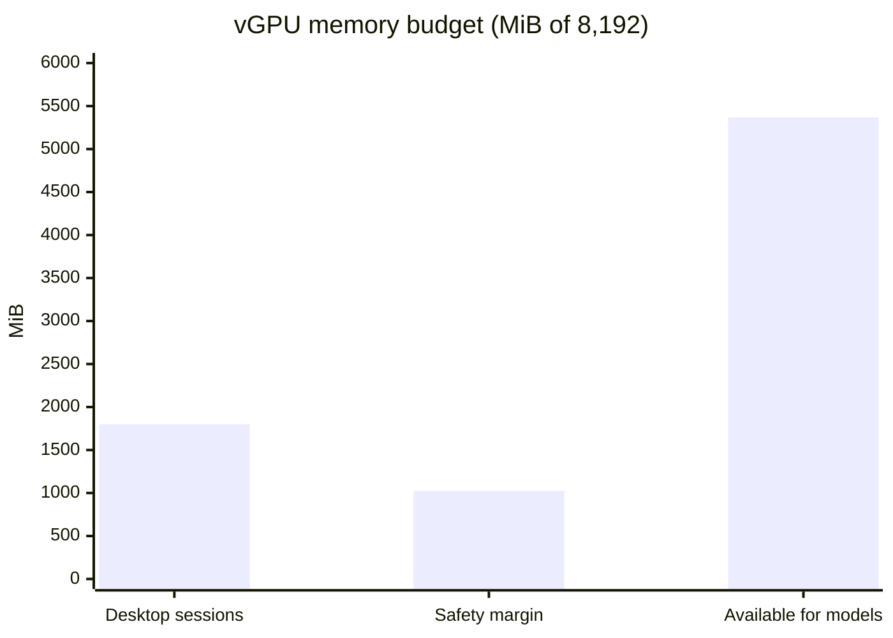

# 01 — Problem, system and constraints

[← Back to README](README.md) · Next: [02 — Methodology →](02-methodology.md)

## 1.1 The problem

Engineering teams accumulate knowledge in READMEs, TODO files, agent instructions and `docs/` folders spread over dozens of repositories. People and coding agents ask the same questions again and again: *which version of the template does this landing page use, why was this decision reversed, what is the timeout of that kiosk*. The answers exist, scattered and sometimes contradictory.

We wanted a system that:

- **compiles** those sources into a linked Markdown wiki (one page per project, decision, technology and concept), keeping every claim tied to a line range of a versioned source;
- **serves** the wiki read-only to agents such as Claude Code through domain tools (search, read a section, follow links, read a source excerpt), never through a raw filesystem;
- **answers** questions with citations that a machine can resolve back to the exact lines, and **abstains** when the corpus does not contain the answer.

The specification set two quality gates for the question-answering phase, and they guided every experiment:

| Gate | Threshold |
| --- | --- |
| Correct answers on answerable questions | **≥ 90%** |
| Citations that actually support the claim they are attached to | **≥ 95%** |
| Abstention on unanswerable questions | correct abstention, no invented answer |

## 1.2 The system in one diagram

Design principles that matter for the rest of this log:

- **Markdown in Git is the source of truth; everything else is derived.** The SQLite index is rebuilt from a commit and is byte-reproducible across platforms: the index built on the VM had the same content hash as the one built on a developer laptop.
- **A citation is a locator, not a URL.** `page#lines=12-18` or `source/version#lines=40-52`. The evaluation harness resolves every citation against the same revision before a judge sees it, so "the model cited something that does not exist" is measured mechanically.
- **The corpus.** 711 source documents imported from about 111 repositories; the first compiled batch covers nine projects: 83 pages, 18 decisions, 27 technology and 20 concept pages, 997 verified citations and 11 explicit contradiction blocks. The text is mostly Italian, with English technical vocabulary.

## 1.3 The machine

The target was decided before any experiment: a Windows Server virtual machine that was already available, instead of a dedicated workstation. That choice set every constraint below.

| Resource | What we had | What it meant |
| --- | --- | --- |
| CPU | 10 logical cores | Shared; CPU inference of auxiliary models had to be bounded |
| RAM | 32 GB, ~20 GB free when the co-tenant's services are active | Model runners' host memory counted against another team's processes |
| GPU | NVIDIA **L40S-8Q** vGPU profile, **8,192 MiB** | ~1,750–1,900 MiB already used by remote-desktop sessions; per-process GPU memory not exposed (`N/A`) |
| Disk | single 349 GB system disk | No separate data disk |
| OS and security | Windows, IT-managed Microsoft Defender with Attack Surface Reduction rules in block mode | Unsigned, low-prevalence executables are killed on launch |
| Network | Port 443 owned by a VDI agent | Our reverse proxy on 8443; internal certificate authority constrained to the VM's names |

### The memory budget

The usable budget for weights, KV cache and runtime buffers was therefore **about 5.3 GiB at peak**. With the original 1,536 MiB margin it was under 4.9 GiB. Everything we loaded had to fit there **with no silent CPU offload**. Ollama moves layers to the CPU without warning when VRAM is short, so the window script compares `size_vram` with `size` and aborts on any partial offload.

## 1.4 Operating rules we could not break

These were not preferences. They were conditions for being allowed to use the machine, and several experimental choices follow from them.

1. **Never stop, restart or update the co-tenant's services, and never reboot the VM.** The machine also hosts another team's pre-production stack (Node, MySQL, Vite, an Apache install). Any action that needed an interruption required asking first.
2. **GPU only inside agreed windows, one model at a time, always unloaded at the end.** The vGPU also serves the co-tenant's desktop sessions. A watchdog samples `nvidia-smi` every 500 ms and stops the benchmark if free VRAM stays below the margin for two consecutive samples ([code](code/vram-watchdog.ts)).
3. **No bypass of endpoint protection.** When the upstream `llama.cpp` server binary was blocked by an ASR rule, we did not ask for an exclusion. We switched to the signed Ollama portable build ([04](04-local-model-selection.md#41-the-runtime-that-was-not-allowed-to-run)).
4. **No global runtime changes.** All runtimes are portable, under the project's own directory, listening on loopback only. The co-tenant's applications use the machine-wide Node.js installation, so upgrading it would have affected them.
5. **Data egress follows a written policy.** Loopback endpoints may receive `internal` and `restricted` content. A non-local endpoint needs an explicit flag **and** an allow-listed origin **and** TLS, and receives `internal` content only. `prohibited_for_llm` content never reaches any model ([code](code/egress-policy.ts)). Sending wiki passages to a cloud model was approved by IT and security for the benchmark on 19 October and for operational use on 22 October.

## 1.5 Why this is a research problem and not a configuration exercise

On paper an 8 GiB GPU runs a 4–9B model comfortably. In practice, three things combined made the design space narrow and non-obvious:

- **The memory is shared and fluctuates.** The model, the KV cache, the reranker and the embedding model compete for about 5 GiB, while desktop sessions can take memory back at any time.
- **Agentic use multiplies context.** A tool-calling agent re-reads its growing history at each step. With a 16k context, small models lost the thread before reaching the evidence.
- **The question distribution was unknown.** The first benchmark was written by the developers, and it hid how far the system was from the gates ([03](03-lexical-baseline.md)).

The rest of this log is the search through that space.

[← Back to README](README.md) · Next: [02 — Methodology →](02-methodology.md)
