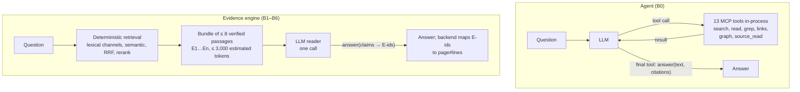
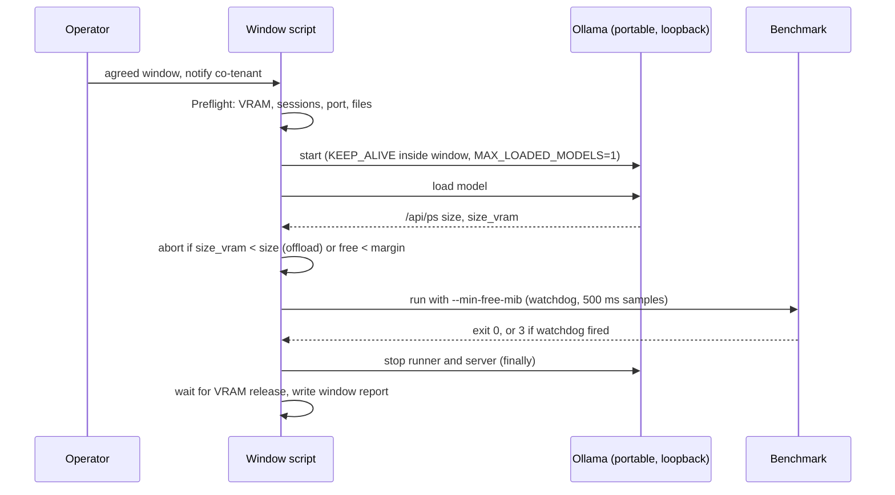

# 02 — Methodology

[← 01 — Problem and constraints](01-problem-and-constraints.md) · [README](README.md) · Next: [03 — Lexical baseline →](03-lexical-baseline.md)

This section describes the evaluation apparatus. It changed twice during the research. Each change was made because a measurement showed the apparatus itself was wrong, and both changes are documented, because they changed the conclusions.

## 2.1 Question sets

| Set | Written by | When | Size | Role |
| --- | --- | --- | --- | --- |
| **F0** | The development side (technical review delegated to an agent) | 12 Oct | 50 (45 answerable, 5 unanswerable) | Lexical retrieval gate for the read-only phase. **Known to development.** |
| **F1 independent** | A Claude agent that had not seen the F0 set, its reports or the roadmap | 13 Oct | 50 (44 + 6) | Main development set from 13 Oct onward. Known to development after the first run. |
| **Holdout 1** | A Claude agent working only on an export of the wiki revision (pages, manifests, extractions), with no access to code, sets or reports | 16 Oct | 50 (44 + 6) | Confirmation of the evidence engine and reader. 5 overlapping questions flagged **before** any run. |
| **Holdout 2** | Same isolation, plus the list of the 100 existing questions to avoid | 22 Oct | 50 (44 + 6) | **Decisive set** for the local/cloud/cascade decision. 3 near-duplicates flagged before the runs. |

All sets use the same category mix, chosen to stress different failure modes:

| Category | Per set | What it tests |
| --- | --- | --- |
| Direct | 12 | A fact stated on one page |
| Synonyms | 10 | Same fact, different vocabulary from the page |
| Multi-hop | 10 | Facts spread over two to five pages |
| Contradictions | 4 | Two pages disagree; the answer must say which prevails |
| Obsolete | 4 | A value changed over time; the answer must give the current one |
| Source detail | 4 | A value present **only in the original source**, not in the compiled wiki |
| Unanswerable | 6 | Absence verified by grep over the wiki and all 711 source extractions |

Every answerable question carries a `reference_answer`, a list of `key_facts`, the `expected_refs` (pages) and, where relevant, `expected_sources` with line locators. The authors also verified their own items: all expected references existed, and every source-detail locator contained the value while the wiki did not.

## 2.2 Systems under test

Two families of answering systems appear throughout:



- In the **agent**, the model decides what to search and read, with a budget of up to 15 tool calls and explicit token and time limits. Three tool profiles were compared: navigation only (index, links, graph), lexical search only, and hybrid (all tools).
- In the **evidence engine**, the model never searches. It receives a fixed bundle of passages, each re-verified against the Git snapshot (same page hash, same lines), and must attach evidence IDs to each claim. Unknown IDs are format errors, never invented sources ([code](code/evidence-reader.ts)).
- The **oracle** (O0) is the evidence engine with the *correct* passages supplied by hand. It separates retrieval failures from reading failures.

## 2.3 Judging

### Protocol v1 (13–15 October)

A blind judge received an anonymised package: question, answer, citations already resolved to their excerpts, and the reference answer with key facts. It did not see which model or profile produced the answer. Rule: `correct` if the answer "contains the key facts" with no relevant false claim. Each citation is `supports: true/false` against its resolved excerpt, and an unresolvable citation is always false.

### What went wrong with v1

On 15 October an independent re-judgement of one batch disagreed on 24 of 50 outcomes. Some judges required **all** key facts, others only the **essential** ones. On 16 October a first full pass with "all key facts" produced near-perfect inter-judge agreement (248/250) but rejected almost everything: 2–4 correct answers out of 44 per configuration, because many key facts were incidental details. A strict rubric made the judges agree with each other, but it no longer measured what we cared about.

### Protocol v2 (from 16 October)

1. **Essential facts, annotated blind.** Two independent annotators saw only the question, reference answer and key facts (never a system answer) and marked each fact *essential* (the question asks for it) or *accessory*. Agreement: 166/167 facts on F1, 120/121 on holdout 1, 165/168 on holdout 2. The union of the two annotations is used.
2. **Per-fact verdicts.** The judge marks every fact present or absent, and flags a relevant false claim. `correct = all essential facts present AND no false claim`. The strict "all facts" metric and fact coverage are derived from the same verdicts.
3. **Two judges per answer**, on reshuffled batches, and a **third judge** on any disagreement.

The full rubric is in [Appendix A](appendix-a-judge-instructions.md).

| Judging round | Answers | Outcome agreement between the two judges | Tie-breaks |
| --- | --- | --- | --- |
| 16 Oct (VM, holdout 1, 9B) | 850 | 840/850 (98.8%) | 10 |
| 19 Oct (frontier) | 400 | 396/400 (99.0%) | 4 |
| 22 Oct (cascade) | 450 | 447/450 (99.3%) | 3 |

The judges were Claude models. None of the systems under test was a Claude model, but the judges were launched by the same agent that was developing the engine. The rubric was always written and versioned before the answers it judged existed. **This is delegated judgement, not human review**, and the quality gates are recorded as "delegated" for that reason.

## 2.4 Statistics

With 44 answerable questions per set, one answer moves the score by 2.3 points. Two tools keep us honest ([code](code/stats.ts)):

- **Wilson 95% intervals** on each proportion.
- **Exact McNemar tests** on *paired* answers: the same questions answered by two systems. Only the discordant pairs count (correct in A only, correct in B only), and the two-sided p-value comes from a binomial(n, ½). We call a difference significant only at p < 0.05. Results are reported as "only A / only B / p".

Pooling the two older sets (88 answerable) was used to gain power where the protocol allowed it. Decisions on the final architecture were taken on a **fresh holdout**, never on pooled development sets.

## 2.5 Decision rules fixed before the runs

For the decisive experiment of 22 October ([08](08-hybrid-cascade.md)) the rule was written into the plan before any answer was generated. The cascade (M) has the best quality-to-price ratio if, on the answerable questions of holdout 2:

1. M beats local-only (L): exact McNemar, p < 0.05;
2. each extra correct answer over L costs less with M than with cloud-only (C):

```
cost(M) / (correct(M) − correct(L))  <  cost(C) / (correct(C) − correct(L))
```

If C is not better than M, condition 2 holds by construction. We also report the price of C's extra answers over M, `(cost(C) − cost(M)) / (correct(C) − correct(M))`: what it would cost to climb to the cloud's level. Provider errors (timeouts, quota 429s) are **not** model outcomes. Those records are removed, the original is kept in a backup, and the question is re-run in the same run.

## 2.6 Reproducibility and run identity

- **Frozen corpus.** Every run uses the same published wiki revision; the index content hash is recorded.
- **Run identity.** Each run records engine, retrieval configuration fingerprint (canonical JSON hash, independent of the preset name), artifact revisions (embedding and reranker model and file SHA256), code hash including uncommitted changes, and prompt version. One run per file, resumable from the same file after an interruption.
- **Deterministic retrieval.** Two executions of the best retrieval configuration gave identical ranks and bundles on 50/50 questions. Indexes, passages and vectors had identical fingerprints on the laptop and the VM.
- **Model files.** Every GGUF was downloaded with a mandatory SHA256 check and imported with an explicit Modelfile (renderer and parser), never pulled from a model library tag.
- **Temperature 0**, one parallel slot, fixed context of 16,384 tokens, thinking disabled for local models (`reasoning_effort: none`) and set to `low` for cloud models.

## 2.7 The GPU window protocol



Each window writes a JSON report: VRAM before, after loading, at peak and after unloading; host memory; the model's `size_vram`; release commit; question file SHA256. The VM's benchmark release was always prepared **without activation**, so the production MCP service was never restarted for an experiment.

## 2.8 Metrics recorded

Correctness and citation support (judged); abstention accuracy; resolvable citations; recall of expected pages, both *opened* and *cited*; valid tool calls and errors by type; stop reasons; time per question p50/p95; time to first token; tokens/s; prompt, completion, reasoning and cached tokens per call; VRAM before/loaded/peak/after; load time; and for retrieval alone `all@k`, `recall@k`, MRR and bundle coverage.

[← 01 — Problem and constraints](01-problem-and-constraints.md) · [README](README.md) · Next: [03 — Lexical baseline →](03-lexical-baseline.md)
