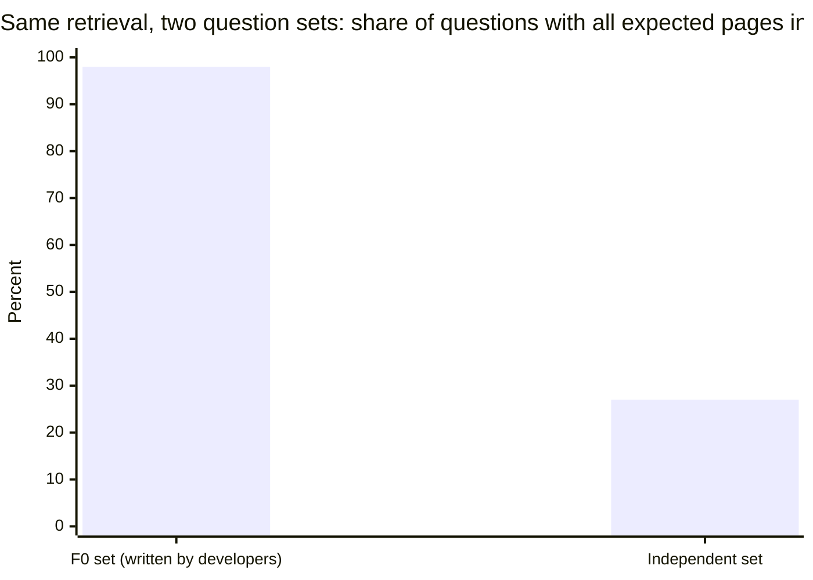

# 03 — Phase F0: the lexical baseline and the 98% illusion

[← 02 — Methodology](02-methodology.md) · [README](README.md) · Next: [04 — Local model selection →](04-local-model-selection.md)

*Dates: 8–13 October 2026. Where: developer laptop, CI (Windows and Linux), VM.*

## 3.1 What F0 was

The first phase deliberately contained **no language model in the answering path**. It had to show that the wiki could be served read-only, reproducibly and safely:

- a snapshot of a commit is read straight from Git objects, with no checkout;
- a SQLite index (FTS5 with BM25, titles and aliases, links, backlinks and graph) is rebuilt from that snapshot. The rebuild is idempotent, and the content hash was identical on macOS and Windows;
- an MCP server exposes 13 read-only tools over stateless Streamable HTTP. Tokens are scoped to a space (`wiki:read`, `sources:read`) and to a fixed revision, cursors are signed, and responses are capped at 32 KB;
- an end-to-end test builds a Git repository, indexes it, starts the HTTP server and calls **every** tool, verifying the data against the files of the commit. It fails if a listed tool is not covered.

F0 closed on 13 October: 106 tests passed on the VM with the production Node version, and a real Claude Code client queried the corpus through the reverse proxy (18 tool calls, 6 source reads, sources and explicit insufficiency in the answer).

## 3.2 The search engine

The lexical search was the classical part of the system:

1. **AND query** over the significant terms of the question, on wiki sections.
2. **Lexicon expansion**: a small versioned dictionary of rewrites and synonyms.
3. **Partial fallback** (added on 12 October): if no section matches all terms, accept sections with at least two significant terms and at least 60% of them.
4. **Diversification**: one section per page, so that a single long page cannot take all the results.

The FTS tokenizer is `unicode61`, with no Italian stemming.

## 3.3 Measurements on the F0 set

| Variant | Hit rate (all expected pages in the top 20) | p95 latency |
| --- | --- | --- |
| AND only (draft questions, 12 Oct) | 60% | 2.4 ms |
| AND + partial fallback (draft questions) | 72% | 4.9 ms |
| AND + fallback, curated set, laptop | 49/50 (98%) | 14.8 ms |
| AND + fallback, curated set, **VM**, production runtime | **49/50 (98%)**: 44/45 answerable, 5/5 abstentions | 19.2 ms |

By the letter of the specification the gate was passed: ≥ 90% on a curated set of 50 questions.

## 3.4 The independent set

On 13 October an agent that had never seen the F0 set, its reports or the roadmap wrote 50 new questions from the wiki and the source extractions alone. We ran **exactly the same retrieval with exactly the same criterion**:

| Category | Hits on the independent set |
| --- | --- |
| Direct | 7/12 |
| Synonyms | **0/10** |
| Multi-hop | **1/10** |
| Contradictions | 2/4 |
| Obsolete | 0/4 |
| Source detail | 2/4 |
| **Total answerable** | **12/44 (27%)** |

The search also returned candidates for 5 of the 6 unanswerable questions. A correct abstention would therefore depend entirely on the model.

## 3.5 Reading

**The F0 set measured the vocabulary of the search engine.** It was curated by people who knew which words the index contained, and it was refined while the lexical fallback was being tuned. Each step was reasonable, and together they over-fitted the benchmark to the system. The independent set used the words a colleague would use, and on those words AND-based lexical search, even with a fallback, failed:

- **synonyms**: no stemming and a hand-written lexicon cannot cover the paraphrases of a real user;
- **multi-hop**: requiring almost every term in the *same section* rules out answers spread over several pages;
- **one section per page**: diversification removes the second relevant section of the same page.

Two methodological decisions came out of this:

1. **Every subsequent claim is made on sets the developers did not write.** The F0 set is still reported for continuity, always labelled "known".
2. **The question for phase F1 changed** from "which model?" to "which model **and** which retrieval?". We nevertheless ran the model comparison first, on the existing tool-calling agent, because it was ready and because it would show how much a model could recover by searching repeatedly ([04](04-local-model-selection.md)).

The 27% is a strict metric. It requires **all** expected pages, and an agent can reformulate and navigate. It is not an upper bound on agent accuracy. As a measure of what the index gives for free, it was low enough to change the plan.

[← 02 — Methodology](02-methodology.md) · [README](README.md) · Next: [04 — Local model selection →](04-local-model-selection.md)
