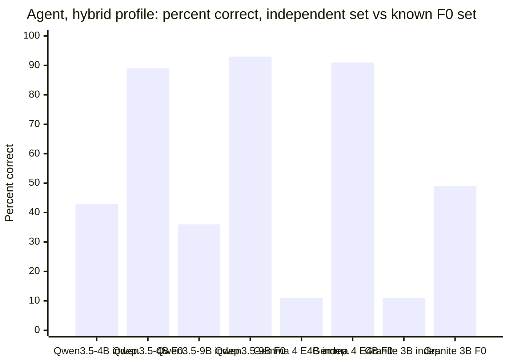

# 04 — Choosing a local model for an 8 GiB vGPU

[← 03 — Lexical baseline](03-lexical-baseline.md) · [README](README.md) · Next: [05 — Retrieval ablations →](05-retrieval-ablations.md)

*Date: 13 October 2026. Where: the VM, inside agreed GPU windows (09:28–12:50 UTC). 1,200 runs (4 models × 3 profiles × 2 sets × 50 questions), all judged with protocol v1.*

## 4.1 The runtime that was not allowed to run

The plan was `llama.cpp` (`llama-server`, release b11429, CUDA 12.4 build), chosen for explicit control of context, KV-cache type and slots. It was downloaded with checksums verified against the GitHub release API. On launch, Microsoft Defender's ASR rule *"advanced protection against ransomware"*, managed by IT and in block mode, terminated the unsigned, low-prevalence executable ("Access denied", Defender event 1121).

Requesting an exclusion on a shared, IT-managed machine was ruled out. The replacement was **Ollama v0.40.3 as a portable zip**, signed by Ollama Inc. (Authenticode verified). It uses the same GGML engine, so the memory estimates still held. Its configuration lives in the process environment only:

```text
OLLAMA_HOST=127.0.0.1:8091        # loopback only
OLLAMA_MODELS=<project>\models     # no user-profile store
OLLAMA_MAX_LOADED_MODELS=1
OLLAMA_NUM_PARALLEL=1
OLLAMA_FLASH_ATTENTION=1
OLLAMA_KV_CACHE_TYPE=q8_0          # never q4_0
OLLAMA_CONTEXT_LENGTH=16384
OLLAMA_KEEP_ALIVE=-1               # inside the window only
OLLAMA_NO_CLOUD=1
```

Model files were imported from verified GGUFs with an explicit `FROM` plus `RENDERER`/`PARSER` Modelfile, instead of library tags. A library tag would have brought a 5.6 GB model plus a 0.9 GB vision projector we did not need.

> **Lesson.** On locked-down corporate hosts the deciding property of an inference runtime can be its *code signature*, not its performance. Check it before you plan benchmarks around a binary.

## 4.2 Candidates

The candidates were selected from primary sources (model cards, GGUF headers read with HTTP range requests, official `config.json`). Memory was **computed** from the headers and then **measured** on the VM. All candidates are Apache-2.0.

| Model | Quantisation | KV cache | Estimated GPU weights | Note |
| --- | --- | --- | --- | --- |
| Qwen3.5-9B | IQ4_XS | q8_0 | ~4.3 GiB, peak ~5.4 | At the edge of the budget |
| Gemma 4 E4B-it | QAT q4_0 | f16 | ~2.6 GiB (+~2.7 GiB host) | Tool calling to be verified |
| Qwen3.5-4B | Q4_K_M | f16/q8_0 | ~2.5 GiB | Small baseline, same tool format as the 9B |
| Granite 4.2 3B | Q4_K_M | f16/q8_0 | ~2.0 GiB | Italian tested by the vendor |

**No 12–14B model fits** without 3-bit quantisation. A "medium" profile was therefore declared not admissible on this VM unless measurements showed otherwise.

## 4.3 Smoke tests found harness bugs, not model bugs

Three five-question smoke tests on the 9B, run before the full comparison, exposed problems in our own harness:

| Smoke test | Observed | Fix |
| --- | --- | --- |
| #1 | 2 of 5 false abstentions; prompts up to 14,148 of 16,384 tokens | Recall with page UUIDs, context budget at 90% of the window, only `answer` allowed once the budget is exhausted, wait for VRAM release |
| #2 | **25% of tool calls failed**: models mis-copied long base64 cursors, passed `limit` > 20 and got a generic error | Short cursor aliases, truncated results with consistent cursors, input errors naming the field and the constraint |
| #3 | 90% valid tool calls, 80% expected pages cited, p50 9.0 s | Context estimate now also counts tool results just added |

The full 9B run then showed 4 of 300 generations hitting the 16,384-token window. The characters-per-token estimate was recalibrated from 3.0 to **1.6** (measured median 2.55, 10th percentile 1.7).

> **Lesson.** Small models are unforgiving of opaque identifiers. A cursor that a frontier model copies without a problem is a 25% failure rate for a 4–9B model. Design tool interfaces for the weakest model you intend to support.

## 4.4 Results

Tool-calling agent, three tool profiles, temperature 0, 16k context, thinking off.

**Independent set** (44 answerable, 6 unanswerable): correct answers.

| Model | Hybrid | Lexical | Navigation | Supporting citations (hyb./lex.) | p50 / p95 (hybrid) | VRAM loaded / peak |
| --- | --- | --- | --- | --- | --- | --- |
| **Qwen3.5-4B Q4_K_M** | **43%** | 41% | 7% | 54% / 54% | 7.1 / 14.7 s | 5,454 / 5,500 MiB |
| Qwen3.5-9B IQ4_XS | 36% | 39% | 20% | 58% / 59% | 8.1 / 15.8 s | 6,978 / 7,022 MiB |
| Gemma 4 E4B QAT | 11% | 23% | 0% | 70% / 57% | 3.7 / 8.0 s | 5,328 / 5,398 MiB |
| Granite 4.2 3B | 11% | 7% | 2% | 0% / 2% | 11.3 / 15.3 s | 5,170 / 5,206 MiB |

**F0 set** (known to development, 45 answerable):

| Model | Hybrid | Lexical | Navigation | Citations (hyb./lex.) |
| --- | --- | --- | --- | --- |
| Qwen3.5-4B | 89% | 96% | 11% | 90% / 90% |
| Qwen3.5-9B | 93% | 96% | 29% | 82% / 89% |
| Gemma 4 E4B | 91% | 98% | 0% | 57% / 57% |
| Granite 4.2 3B | 49% | 33% | 4% | 0% / 5% |



All four models passed the 90% gate on the known set, or came close, and all four failed it by a wide margin on the independent set. **The F0 set could not tell the candidates apart.**

## 4.5 Decision of 13 October

- **Small profile: Qwen3.5-4B Q4_K_M.** It was best or tied on the independent set (a 5-point gap on 44 questions is within noise), and equal to the 9B on the known set with better citations. It leaves ~2.7 GiB of VRAM margin instead of ~1.2 GiB and runs at ~144 tokens/s versus ~105.
- **Medium profile: not justified on this VM.** The 9B did not improve quality inside the agent and consumed the margin.
- **Excluded:** Gemma 4 E4B answered in free text instead of calling the final `answer` tool, never abstained on the F0 unanswerables, and was confused by the end-of-budget message. Granite 4.2 3B produced citations that almost never resolved, abstained widely and ran close to the context limit.
- **Navigation alone is not viable**: with 16k of context the models lost their way between pages before reaching the evidence.

## 4.6 What we concluded, and what turned out to be wrong

At the time we wrote: *"the main limit is retrieval, not the model."* That was half right. Retrieval was the first bottleneck ([05](05-retrieval-ablations.md)). The finding that the 9B "does not help" was specific to the **agent loop**. Three days later, on the same VM, the 9B was significantly better than the 4B once it was used only as a *reader* of fixed evidence ([06](06-vm-validation.md#65-the-9b-as-a-reader)). In this setting, a model comparison means little unless the architecture is fixed too.

[← 03 — Lexical baseline](03-lexical-baseline.md) · [README](README.md) · Next: [05 — Retrieval ablations →](05-retrieval-ablations.md)
