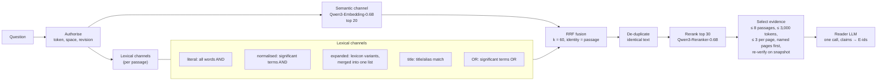
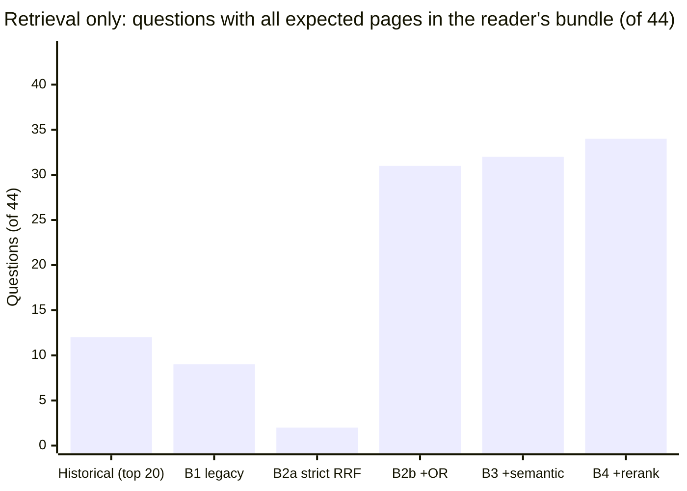
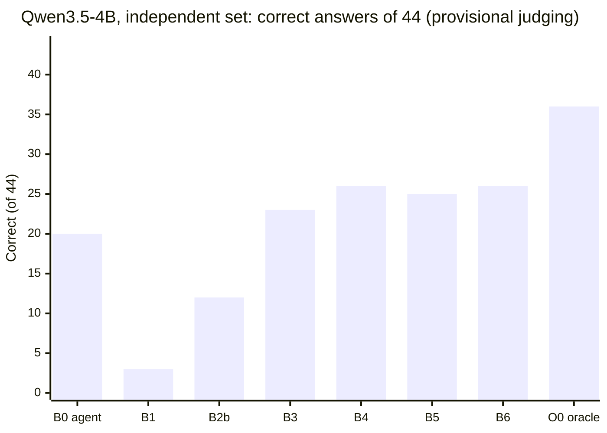

# 05 — Retrieval ablations: from agent to evidence engine

[← 04 — Local model selection](04-local-model-selection.md) · [README](README.md) · Next: [06 — VM validation →](06-vm-validation.md)

*Date: 15 October 2026. Where: developer laptop (Apple M2 Max, 32 GiB, Ollama 0.40.3 on Metal), same GGUF as the VM. Reader: Qwen3.5-4B Q4_K_M. Set: independent F1 set. Judging: provisional protocol v1, later re-judged with v2 ([06](06-vm-validation.md)).*

## 5.1 Hypothesis and design

The model comparison left two explanations for the 43% ceiling: the model could not *find* the evidence, or could not *read* it. A targeted literature review on 15 October suggested, in order of expected value for cost:

1. measure retrieval and reading **separately**, with an oracle given the correct passages;
2. make lexical ranking more permissive and combine channels with **Reciprocal Rank Fusion** (Cormack, Clarke and Büttcher, SIGIR 2009) instead of comparing raw BM25 scores across different queries, which are not calibrated against each other;
3. add a **small multilingual embedding** channel for paraphrases;
4. add a **small cross-encoder reranker** to fix wrong-page and wrong-project errors;
5. give the model **short, verified context with pre-assigned citation IDs** instead of a tool loop;
6. only then try linked original sources and graph expansion.

We implemented this as a new, opt-in retrieval path (`src/retrieval/`) in seven milestones, M0–M6. The MCP tools, the chat client and the historical profiles were left unchanged. Every variant is a frozen configuration with a stable fingerprint ([code](code/retrieval-presets.ts)).

### The pipeline

Passages are 200–400 estimated tokens and are cut along the Markdown structure, giving 737 passages over 83 pages. Each passage carries its page title, heading path and page status (for example `superseded`), so it can be read on its own.

### Variants

| ID | Name | Lexical | Semantic | Rerank | Extra |
| --- | --- | --- | --- | --- | --- |
| B0 | agent, hybrid profile | via tools | — | — | tool loop, up to 15 calls |
| B1 | `evidenza-legacy` | historical `retrieve()` only | — | — | — |
| B2a | `rrf` | strict channels, RRF | — | — | — |
| B2b | `rrf-or` | strict + **OR**, RRF | — | — | — |
| B3 | `rrf-or-sem` | strict + OR | **always** | — | — |
| B4 | `rrf-or-sem-rerank` | strict + OR | always | **yes** | — |
| B5 | `b4-fonti` | as B4 | always | yes | + linked original sources |
| B6 | `b4-grafo-adattivo` | as B4 | always | yes | + one-hop graph expansion when needed |
| O0 | oracle | correct passages given by hand | | | |
| O1 | oracle + 4 distractors | | | | |

## 5.2 Retrieval only (no generation)

44 answerable questions. `all@k` is the number of questions with **all** expected pages among the pages of the top *k* passages, the same strict criterion as the 27% of [03](03-lexical-baseline.md). `bundle` is the same count on the ≤ 8 passages actually given to the reader.

| Variant | all@5 | all@20 | bundle | recall@20 | MRR | p95 |
| --- | --- | --- | --- | --- | --- | --- |
| Historical `retrieve()` (pages) | 12 | 12 (27%) | — | 0.37 | 0.44 | 18 ms |
| B1 legacy as evidence | 7 | 9 | 9 | 0.29 | 0.33 | 14 ms |
| B2a strict channels + RRF | 2 | 2 | 2 | 0.07 | 0.11 | 8 ms |
| B2b + OR channel | 23 | 31 | 31 | 0.88 | 0.77 | 10 ms |
| B3 + semantic, multilingual-E5-small | 20 | 33 | 24 | 0.87 | 0.67 | 12 ms |
| B3 + semantic, Qwen3-Embedding-0.6B | 27 | 34 | 32 | 0.93 | 0.83 | 15 ms |
| Ablation: OR + rerank, no semantic | 26 | 32 | 30 | 0.89 | 0.93 | 1.6 s |
| B4, E5-small | 26 | 34 | 33 | 0.91 | 0.92 | 2.4 s |
| **B4, Qwen3-Embedding-0.6B** | **27** | **37** | **34** | **0.95** | 0.92 | 2.3 s |
| B5 + linked sources | 27 | 37 | 34 | 0.95 | 0.92 | 3.4 s |
| B6 + adaptive graph | 27 | 37 | 35 | 0.95 | 0.92 | 2.2 s |

*The first bar is the historical `all@20` on pages; the others are bundle coverage on ≤ 8 passages. Bundle coverage is stricter, so the gains are, if anything, understated.*

What the ablation shows:

- **The biggest single gain is the OR channel (12 → 31).** The historical search required almost every word of the question in the same section and returned *nothing* for 23 questions. Fusing the strict channels alone (B2a) made things worse, because they were all empty together.
- **Embedding choice matters more than whether you add one.** A third-party GGUF conversion of multilingual-E5-small helped the top 20 but *hurt* the top positions and the bundle (31 → 24). Qwen3-Embedding-0.6B (official GGUF, Q8_0) improved every metric.
- **The "semantic only as a fallback" rule (when fewer than 3 strict passages are found) fired on 49 of 50 questions.** With these channels it is not selective, so B3 runs semantic always.
- **The reranker fixes ordering** (MRR 0.77 → 0.92) and costs 1.4–1.9 s median on the laptop.
- The 10 residual misses of B4 are mostly multi-hop and obsolete questions with 3–5 expected pages, more than an 8-passage bundle can hold.

## 5.3 Generation and judgement

Same 50 questions, one repetition per variant, Qwen3.5-4B as the reader (or as the agent for B0).

| ID | Variant | Correct | 95% CI | Correct abstentions | Undue "don't know" | Supporting citations | p50 / p95 (laptop) |
| --- | --- | --- | --- | --- | --- | --- | --- |
| B0 | agent, hybrid | 20/44 (45%) | 32–60% | 3/6 | 4 | 84% | 40.6 / 93.9 s |
| **O0** | **oracle** | **36/44 (82%)** | 68–90% | 5/6 | 0 | 85% | 5.0 / 8.1 s |
| O1 | oracle + 4 distractors | 30/44 (68%) | 53–80% | 5/6 | 0 | 76% | 6.2 / 9.8 s |
| B1 | evidence + legacy lexical | 3/44 (7%) | 2–18% | 5/6 | 28 | 61% | 2.2 / 7.9 s |
| B2b | `rrf-or` | 12/44 (27%) | 16–42% | 5/6 | 5 | 61% | 6.2 / 9.0 s |
| B3 | `rrf-or-sem` | 23/44 (52%) | 38–66% | 5/6 | 6 | 65% | 6.7 / 9.3 s |
| **B4** | **`rrf-or-sem-rerank`** | **26/44 (59%)** | 44–72% | 5/6 | 1 | 70% | 9.2 / 12.1 s |
| B5 | B4 + sources | 25/44 (57%) | 42–70% | 4/6 | 2 | 71% | 11.2 / 15.5 s |
| B6 | B4 + graph | 26/44 (59%) | 44–72% | 5/6 | 2 | 70% | 9.0 / 12.7 s |
| B5+B6 | both | 24/44 (55%) | 40–68% | 4/6 | 1 | 65% | 11.3 / 15.8 s |

Paired comparisons (exact McNemar):

| Comparison | Only first | Only second | p |
| --- | --- | --- | --- |
| B0 → O0 (perfect retrieval) | 2 | 18 | **< 0.001** |
| B0 → B2b | 10 | 2 | **0.039** (B2b worse) |
| B2b → B3 (semantic) | 0 | 11 | **0.001** |
| B3 → B4 (reranker) | 3 | 6 | 0.51 |
| B0 → B4 | 6 | 12 | 0.24 |
| B4 → B5 (sources) | 5 | 4 | 1.0 |
| B4 → B6 (graph) | 1 | 1 | 1.0 |
| O0 → O1 (distractors) | 8 | 2 | 0.11 |

## 5.4 Reading

1. **Retrieval was the main limit, but not the only one.** With the right passages the 4B goes from 45% to 82% (p < 0.001). It still stays below 90%: contradictions 1/4 even with the oracle, multi-hop 6/10, and four distractors cost about six answers. The gate needed a better reader as well as better retrieval.
2. **Deterministic orchestration alone does not beat an agent.** With weak lexical retrieval (B1, B2b) the evidence engine is *worse* than the agent, which compensates by searching repeatedly. It becomes competitive only with the semantic channel.
3. **It is an order of magnitude faster.** One generative call per question instead of ~9.5, and a p95 of 12 s instead of 94 s on the laptop. The largest prompt was 5,297 real tokens of a 16,384 window.
4. **Citations got worse, for a fixable reason.** Support fell from 84% (agent) to 70% (B4). The engine cites more (2.6 citations per answer vs 1.5), and it **attached citations to abstentions**, which the judge correctly counts as not supporting anything. A fix was proposed (no citations on abstentions, a cap per claim) but deliberately **not applied** to the engine just measured on this set. It became reader v2 and was tested on new questions ([06](06-vm-validation.md#64-reader-v2)).
5. **Linked sources (M5) work where they should and hurt elsewhere.** Source-detail questions went from 0/4 to 3/4, but the extra passages distracted the reader on multi-hop (4 → 2) and synonyms (9 → 7), with no net gain and +3.4 s p95. Kept available, disabled by default.
6. **Graph expansion (M6) added one expected page to one bundle and no correct answers.** Disabled. Personalised PageRank was not introduced.

**Candidate configuration: B4** (lexical + OR + Qwen3-Embedding-0.6B + Qwen3-Reranker-0.6B, RRF). **Cheaper alternative: B3**: three fewer answers (not significant), no reranker, 1–1.7 GB less memory. **Rollback**: the agent remains the default engine.

## 5.5 The judge was also being measured

An independent repeat of B4's judgement agreed on 48/50 outcomes. On another batch, however, two judges disagreed on **24 of 50** outcomes. One required all key facts, the other only the essential ones, and the v1 rubric ("contains the key facts") did not say which. With the strict judge, B5 dropped to 20/44 and B6 to 18/44. The comparison between B4 and B5/B6 depended on the judge. This finding led to protocol v2 ([02](02-methodology.md#protocol-v2-from-16-october)). Under v2, the provisional figures of this page were revised: B4 on the laptop went from 26 to 22/44, and B0 from 20 to 19/44.

## 5.6 Auxiliary model notes

| Role | Artifact | Note |
| --- | --- | --- |
| Embedding (chosen) | Qwen3-Embedding-0.6B, official GGUF Q8_0 | Query instruction, runtime pooling and normalisation |
| Embedding (compared) | multilingual-E5-small, third-party GGUF F16 | The official E5 is published only as safetensors/ONNX, which would have needed a new native dependency |
| Reranker (used) | Qwen3-Reranker-0.6B, causal GGUF Q8_0 | Official scoring: P("yes") from the first-token logprobs |
| Reranker (alternative) | Qwen3-Reranker-0.6B with `rank` pooling | Same scores (Δ < 0.001), but returned null vectors after Qwen3-Embedding was loaded on this Ollama version (reproducible); the adapter reports it as an error |

Memory on Ollama (laptop, `/api/ps`): 4B 3,076 MiB; Qwen3-Embedding 2,812 MiB at 16k context, **1,923 MiB at 2k**; reranker 1,688 MiB at 16k, **755 MiB at 2k**. On the VM, with ~1.8 GiB taken by desktops and the 4B at ~5.4 GiB, the auxiliaries **cannot** all sit in GPU next to the reader. Section [06](06-vm-validation.md) is about how we fitted them anyway.

## References for this section

- G. V. Cormack, C. L. A. Clarke, S. Büttcher. *Reciprocal Rank Fusion outperforms Condorcet and individual rank learning methods.* SIGIR 2009.
- X. Wang et al. *Searching for Best Practices in Retrieval-Augmented Generation.* 2024. arXiv:2407.01219.
- L. Wang et al. *Multilingual E5 Text Embeddings: A Technical Report.* 2024. arXiv:2402.05672.
- J. Chen et al. *BGE M3-Embedding.* 2024. arXiv:2402.03216.
- Y. Zhang et al. *Qwen3 Embedding: Advancing Text Embedding and Reranking Through Foundation Models.* 2025. arXiv:2506.05176.
- N. F. Liu et al. *Lost in the Middle: How Language Models Use Long Contexts.* TACL 2024.
- H. Joren et al. *Sufficient Context: A New Lens on Retrieval Augmented Generation Systems.* ICLR 2025. arXiv:2411.06037.
- Anthropic. *Contextual Retrieval.* 2024.

[← 04 — Local model selection](04-local-model-selection.md) · [README](README.md) · Next: [06 — VM validation →](06-vm-validation.md)
