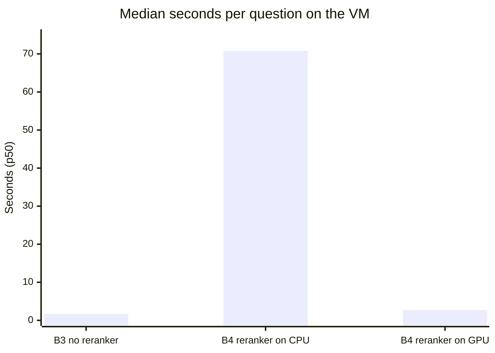
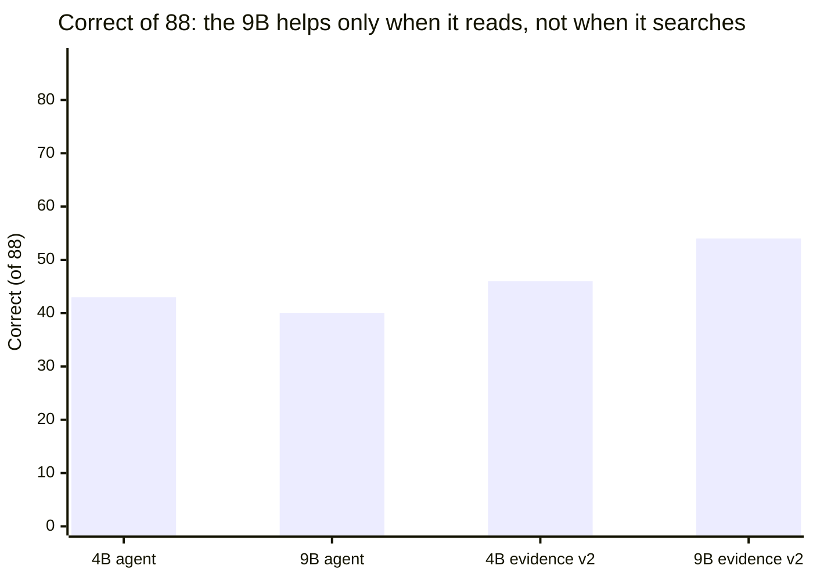

# 06 — Validation on the VM, a better judge and a better reader

[← 05 — Retrieval ablations](05-retrieval-ablations.md) · [README](README.md) · Next: [07 — Frontier ceiling →](07-frontier-ceiling.md)

*Dates: 15–16 October 2026. Where: the VM (Ollama 0.40.3, vGPU L40S-8Q), in agreed windows. The co-tenant's services were never touched. 850 answers, each judged twice with protocol v2.*

## 6.1 Moving the pipeline onto the shared GPU

The laptop results said B4 was the candidate. The VM had to show it would fit and run within the margins. Three placements were tried, all with the 4B reader in GPU and the embedding model **in CPU** (2 threads, 2k context):

| VM, 50 questions | B3 (no reranker) | B4, reranker in CPU | B4, reranker in GPU |
| --- | --- | --- | --- |
| Expected pages opened (recall) | 0.867 | 0.897 | 0.897 |
| Expected pages cited (recall) | 0.662 | 0.679 | 0.713 |
| Correct abstentions | 5/6 | 5/6 | 5/6 |
| Undue abstentions | 5 | 3 | 2 |
| Time per question p50 / p95 | 1.7 / 2.7 s | **70.8 / 80.1 s** | **2.7 / 5.0 s** |
| Reranking p50 | — | 69.0 s | 1.0 s (p95 3.0 s) |
| VRAM peak (of 8,192 MiB) | 5,606 | 5,606 | 7,003 |
| Minimum free commit | 7.6 GiB | 3.0 GiB | 6.0 GiB |

**A 0.6B reranker on 30 candidates is unusable on a shared 10-core CPU** (69 s per question). In GPU it costs about a second. To make room, the VRAM margin was lowered from 1,536 to **1,024 MiB**, with explicit agreement and on the condition that the co-tenant's services were never affected. With 1,536 MiB the watchdog stopped the run at 1,320 MiB free; with 1,024 the run kept ~1,190 MiB free.

The query embedding (p50 375 ms in CPU) is computed in a separate batch phase and is **excluded** from the timings above, so real per-question times are about 0.4 s higher.

## 6.2 The RAM commit trap

During the first reranker-in-GPU window, the VM's **free commit charge fell from 17.2 GiB to 1.0 GiB in about one minute**. The window's host-memory guard stopped Ollama before any other process was affected.

The cause: each `llama-server` runner spawned by Ollama keeps a **host-RAM prompt cache of up to 8,192 MiB** by default. With the reader and the reranker both loaded, two runners reserved commit for two caches, on a machine whose RAM was shared with another team's database and Node services.

| Setting | 4B runner private memory | Reranker runner | Min free commit during window | Time to first token |
| --- | --- | --- | --- | --- |
| Prompt cache default (8 GiB) | ~7.6 GiB | 5.3 GiB (CPU) | **1.0 GiB** (stopped) | 1.66 s |
| `LLAMA_ARG_CACHE_RAM=0` | 5.75 GiB | 1.97 GiB (GPU) | **6.0 GiB** | 1.63 s |

Disabling the prompt cache cost nothing measurable in latency, because every benchmark prompt is different, and it made the configuration safe. The window script now exposes it as `-CacheRamMiB 0`, and the guard samples free commit every ~5 s and stops below ~4.5 GiB.

> **Lesson.** On a shared host, VRAM is not the only budget that matters. Inference runtimes make generous host-memory defaults that assume they own the machine. Measure commit charge, not just "free RAM", and set every cache explicitly.

## 6.3 Determinism across platforms

Index, passages and vectors had identical fingerprints on the laptop and the VM. On the VM, the candidates before reranking were identical across B3, B4-CPU and B4-GPU. The laptop differed from the VM in 27 of 50 questions, because embeddings computed on Metal and on CPU are not bit-identical. Reranker scores differed between CPU and GPU (median gap 0.004, p95 0.071), and the top-8 passages were identical in 13 of 50 questions. Despite this, laptop and VM results were statistically equivalent once judged (B4 laptop → B4-GPU VM: 0 vs 2, p = 0.50).

## 6.4 Reader v2

The citation fix proposed on 15 October was implemented as an optional reader, `--reader v2`, so that runs already measured would keep their identity. Changes, all in the prompt and in the answer tool ([code](code/evidence-reader.ts)):

- **no citations on abstentions** (also enforced in the backend);
- **1–3 evidence IDs per claim** (v1 allowed 6), and "do not cite passages that are only related to the topic";
- explicit rules for **conflicting evidence** (report both, with IDs, and state which prevails: `superseded`/`deprecated` status, later date, later decision, contradiction note) and for **values that changed over time** (current and previous);
- **completeness**: report all the facts that answer the question, not just the first one; a partial answer is allowed with `insufficient = false` and a statement of what is missing.

## 6.5 The 9B as a reader

The 9B had not helped as an agent ([04](04-local-model-selection.md)). As a reader the situation is different: the model no longer chooses tools or copies identifiers. It only reads eight passages and writes claims. That is close to pure reading comprehension, where parameter count usually helps.

**The memory problem:** with the 9B loaded, 1,261 MiB stay free. The reranker in GPU (~750 MiB) does not fit next to it inside the 1,024 MiB margin. The benchmark therefore runs in **stages** (`MAX_LOADED_MODELS=1`): retrieval for all questions first (embedding in CPU, reranker in GPU), then the 9B is loaded once and answers all of them. First answer 9.8 s, then p50 3.2–3.3 s. VRAM peak 6,967–6,975 MiB; minimum free RAM 13.3 GiB.

## 6.6 Results (protocol v2, two judges per answer)

### Independent F1 set (44 answerable)

| ID | Configuration | Correct | 95% CI | Supporting citations | p50 / p95 |
| --- | --- | --- | --- | --- | --- |
| B0 | 4B agent, hybrid | 19/44 (43%) | 30–58% | 66% | 7.3 / 11.7 s |
| B3 | 4B evidence, lexical + semantic | 16/44 (36%) | 24–51% | 55% | 1.7 / 2.7 s |
| B4 | + reranker CPU | 23/44 (52%) | 38–66% | 59% | 70.8 / 80.0 s |
| B4g | + reranker GPU | 24/44 (55%) | 40–68% | 60% | 2.8 / 5.0 s |
| B4g-v2 | B4g with reader v2 | 22/44 (50%) | 36–64% | **80%** | 2.7 / 4.7 s |
| O0 | 4B oracle | 32/44 (73%) | 58–84% | 80% | 1.4 / 2.1 s |

Reranker B3 → B4g: 2 vs 10, **p = 0.039**. B4g-v2 → oracle: 2 vs 12, **p = 0.013**.

### Holdout 1 (44 answerable, new questions)

| Configuration | Correct | Supporting citations | Correct abstentions |
| --- | --- | --- | --- |
| 4B agent | 24/44 (55%) | 67% | 6/6 |
| 4B B4g | 22/44 (50%) | 55% | 6/6 |
| 4B B4g-v2 | 24/44 (55%) | **77%** | 6/6 |

Holdout 1 turned out to be **easier for retrieval**: B4 delivered **98%** of the expected pages to the reader (90% on F1) and the answer cited 88–90% of them. Correct answers still did not go up. **The bottleneck had moved to the reader.**

### Both sets together (88 answerable), 4B versus 9B

| Reader | Engine | Correct | Supporting citations | p50 |
| --- | --- | --- | --- | --- |
| Qwen3.5-4B | agent | 43/88 (49%) | 66% | 7.3 s |
| Qwen3.5-4B | B4g v1 | 46/88 (52%) | 58% | 2.4–2.8 s |
| Qwen3.5-4B | B4g v2 | 46/88 (52%) | 78% | 2.6–2.7 s |
| Qwen3.5-9B | agent | 40/88 (45%) | 60% | 8.1–8.5 s |
| Qwen3.5-9B | B4g v1 | 53/88 (60%) | 66–71% | 3.2–3.3 s |
| **Qwen3.5-9B** | **B4g v2** | **54/88 (61%)** | **80%** | 3.2–3.3 s |

| Paired comparison (88) | Only first | Only second | p |
| --- | --- | --- | --- |
| Evidence v2: 4B → 9B | 2 | 10 | **0.039** |
| Agent: 4B → 9B | 12 | 9 | 0.66 |
| 9B: agent → evidence v2 | 10 | 24 | **0.024** |
| 4B: agent → evidence v2 | 14 | 17 | 0.72 |
| 4B: evidence v1 → v2 | 4 | 4 | 1.0 |

## 6.7 Reading

1. **Best measured local configuration: Qwen3.5-9B reading B4 evidence with reader v2.** 54/88 (61%), 77–83% supporting citations, 6/6 correct abstentions on holdout 1, 3.2 s median in the benchmark. Significantly better than the 4B on the same pipeline and than the 9B as an agent.
2. **Model size and architecture interact.** The same 9B is no better than the 4B in a tool loop, and 8 answers better as a reader. Comparing models without fixing the architecture would have discarded the better model.
3. **Reader v2 raises citation support by 14–22 points, repeatedly, on both models and both sets, with no loss of answers.** It is the reader we kept.
4. **The reranker earns its place** (+8 net, p = 0.039) at ~1 s in GPU.
5. **Operational cost of the 9B.** In interactive use each question would pay two model swaps (~5 s to load the 9B, plus the reranker), or the reranker in CPU (~69 s). The 3.2 s median holds only for staged batch retrieval. Running 9B and reranker together needs either a lower margin, more VRAM, or a different reranker.
6. **Gates still not met:** 61% vs 90% correct, 80% vs 95% citations.
7. **The provisional laptop judgement of 15 October was optimistic.** Under v2 the laptop's B4 dropped from 26 to 22/44.

The next question followed from point 1: if the local reader is the bottleneck, **how good does the system get with a much stronger reader on exactly the same evidence?**

[← 05 — Retrieval ablations](05-retrieval-ablations.md) · [README](README.md) · Next: [07 — Frontier ceiling →](07-frontier-ceiling.md)
