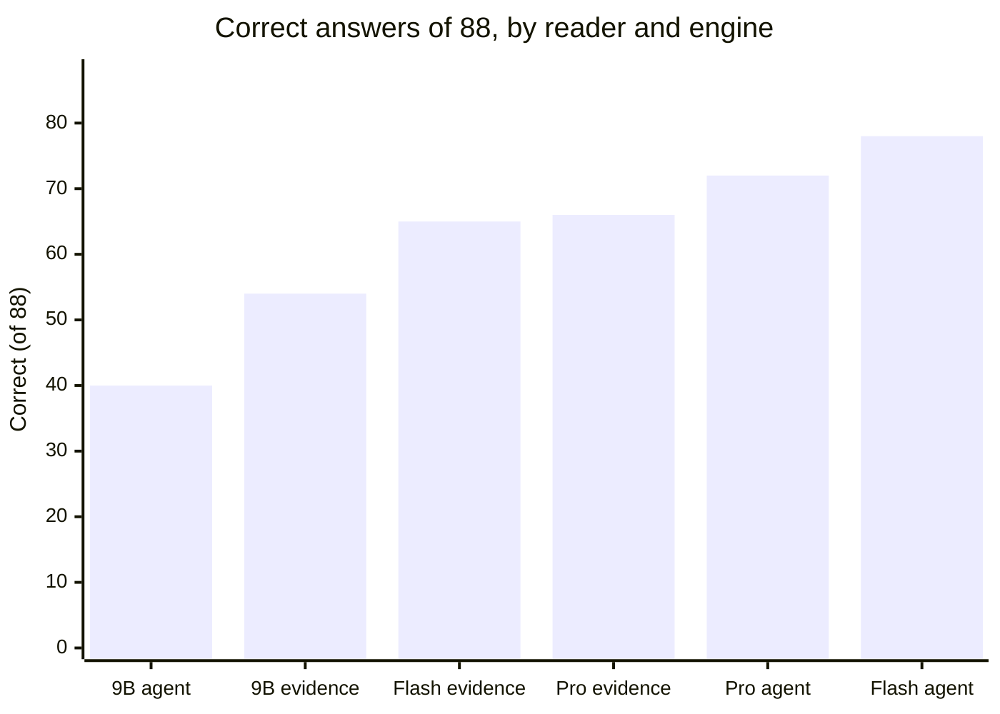
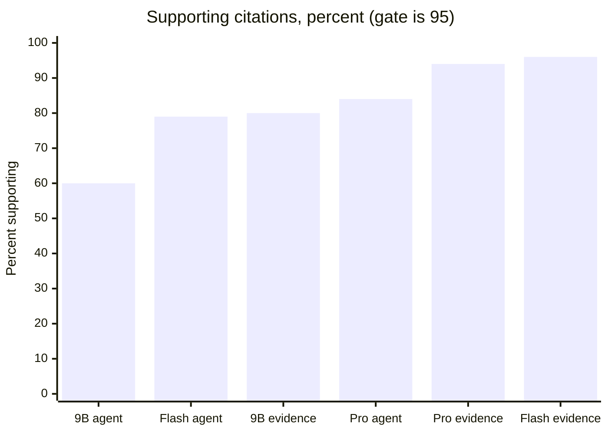

# 07 — The frontier ceiling

[← 06 — VM validation](06-vm-validation.md) · [README](README.md) · Next: [08 — Local, cloud and cascade →](08-hybrid-cascade.md)

*Date: 19 October 2026. Where: generation from the developer laptop to Vertex AI; retrieval (embedding and reranker) on the laptop with the same artifacts as the VM. Same harness, same two sets (F1 + holdout 1), same protocol v2. 400 answers, agreement between the two judges 396/400.*

## 7.1 Purpose

This experiment was **not** a candidate for the VM. It was a ceiling measurement: replace only the language model with a frontier model, keep everything else identical, and see where the local system loses. Egress of wiki passages to the cloud provider was approved by IT and security for this benchmark, and the egress policy ([code](code/egress-policy.ts)) enforced it. Data could be processed outside the EU, because on the cloud project used the EU regions did not serve the model generation needed.

Models: `gemini-3.7-flash` and `gemini-3.1-pro-preview`, temperature 0, `reasoning_effort: low`, 1,024 output tokens per call as for the local models. The agent's context was not trimmed at 16k for the cloud models, but a 120,000-token budget per question remained.

## 7.2 Results (88 answerable questions, two sets)

| Configuration | Correct | Supporting citations |
| --- | --- | --- |
| **Agent, Gemini Flash** | **78/88 (89%)** | 79% |
| Agent, Gemini Pro preview | 72/88 (82%) | 84% |
| Evidence B4 v2, Gemini Pro | 66/88 (75%) | 94% |
| Evidence B4 v2, Gemini Flash | 65/88 (74%) | **96%** |
| Evidence B4 v2, Qwen3.5-9B (VM, 16 Oct) | 54/88 (61%) | 80% |
| Agent, Qwen3.5-9B (VM, 16 Oct) | 40/88 (45%) | 60% |

Per set:

| Configuration | F1 set (44) | Holdout 1 (44) | p50 / p95 (F1) |
| --- | --- | --- | --- |
| Agent, Flash | 37 (84%) | **41 (93%)** | 22.7 / 145.7 s |
| Agent, Pro | 32 (73%) | 40 (91%) | 18.2 / 41.4 s |
| Evidence, Flash | 31 (70%) | 34 (77%) | 6.5 / 7.8 s |
| Evidence, Pro | 32 (73%) | 34 (77%) | 9.7 / 12.7 s |

Paired comparisons:

| Comparison | Only first | Only second | p |
| --- | --- | --- | --- |
| Evidence: 9B → Flash | 3 | 14 | **0.013** |
| Evidence: 9B → Pro | 1 | 13 | **0.002** |
| Evidence: Flash → Pro | 1 | 2 | 1.0 |
| Agent: 9B → Flash | 0 | 38 | **< 0.001** |
| Agent: Flash → Pro | 7 | 1 | 0.070 |
| Flash: agent → evidence | 17 | 4 | **0.007** (evidence worse) |

## 7.3 Where the gap is

By category, Flash on the F1 set:

| Category | Agent | Evidence engine |
| --- | --- | --- |
| Direct | 12/12 | 11/12 |
| Synonyms | 10/10 | 9/10 |
| Multi-hop | 6/10 | 5/10 |
| Contradictions | 1/4 | 3/4 |
| Obsolete | 4/4 | 3/4 |
| **Source detail** | **4/4** | **0/4** |

Over both sets, source detail is **8/8 for the agent and 0/8 for the evidence engine**. The agent opens the original documents through `source_read`, while the evidence engine reads only wiki passages. Linked sources (B5) were disabled because they distracted the small reader ([05](05-retrieval-ablations.md#54-reading)).

## 7.4 Tokens and cost

| Model, engine | Calls | Input tokens | Output tokens (excl. thinking) | Input per question |
| --- | --- | --- | --- | --- |
| Flash, agent | 786 | 6,338,578 | 56,006 | ~63k |
| Flash, evidence | 100 | 319,383 | 21,113 | ~3.2k |
| Pro, agent | 679 | 5,279,309 | 42,259 | ~53k |
| Pro, evidence | 100 | 319,383 | 17,766 | ~3.2k |

**The agent consumes about 20 times the tokens of the evidence engine.** At the introductory Flash list price ($0.75/M input, $3.75/M output, doubling from 1 January 2027), the 200 Flash agent answers cost about $5.3 plus thinking tokens. The provider's `completion_tokens` excluded thinking, so the harness was changed to record `reasoning_tokens` and cached tokens per call for the next experiment.

## 7.5 Reading

1. **The local bottleneck is the reader, not retrieval.** On the *same passages*, Flash and Pro answer 65–66/88 against 54/88 for the 9B. On the F1 set they reach the level of the 4B *oracle* (31–32 vs 32/44), which had the correct passages. Across the 88 questions, Flash and Pro got right 13–14 answers the 9B had wrong with almost the same retrieval, and lost 1–3.
2. **With a capable reader, the agent beats the evidence engine** (78 vs 65 with Flash, p = 0.007), the reverse of the local models (9B: 40 vs 54). A strong model can use the freedom to search: source detail 8/8 vs 0/8, multi-hop 14/20 vs 12/20.
3. **Citations follow the engine, not the model.** With reader v2 on verified passages, support is 94–97%, at the 95% gate. With the agent it is 78–87%. The evidence engine binds each citation to a re-verified passage, while the agent cites pages and sources with broader locators.
4. **The preview "Pro" model was not worth it here.** No gain on evidence, 6 fewer answers as an agent (p = 0.07), slower and more expensive.
5. **No single configuration meets both gates.** The agent has the answers (89%) and the evidence engine has the citations (95–96%).

That suggested a design question: **can we get most of the agent's answers at close to the evidence engine's cost and citation quality?**

## 7.6 Limits

- Generation ran on the laptop, not on the VM: latency is not comparable with local models and does not justify a VM profile.
- Retrieval also ran on the laptop. The bundles given to the cloud reader matched those of the 9B on the VM as a set in 61 of 100 questions (mean Jaccard 0.90), so the 9B comparison mixes a small retrieval effect into the reader effect. Between Flash and Pro, retrieval was identical.
- `reasoning_effort: low` for the cloud models versus thinking off for the 9B.
- The F1 set was known to development; holdout 1 has 5 flagged overlaps.

[← 06 — VM validation](06-vm-validation.md) · [README](README.md) · Next: [08 — Local, cloud and cascade →](08-hybrid-cascade.md)
