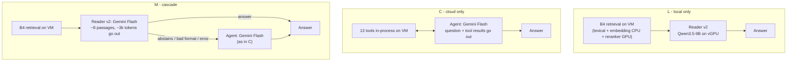
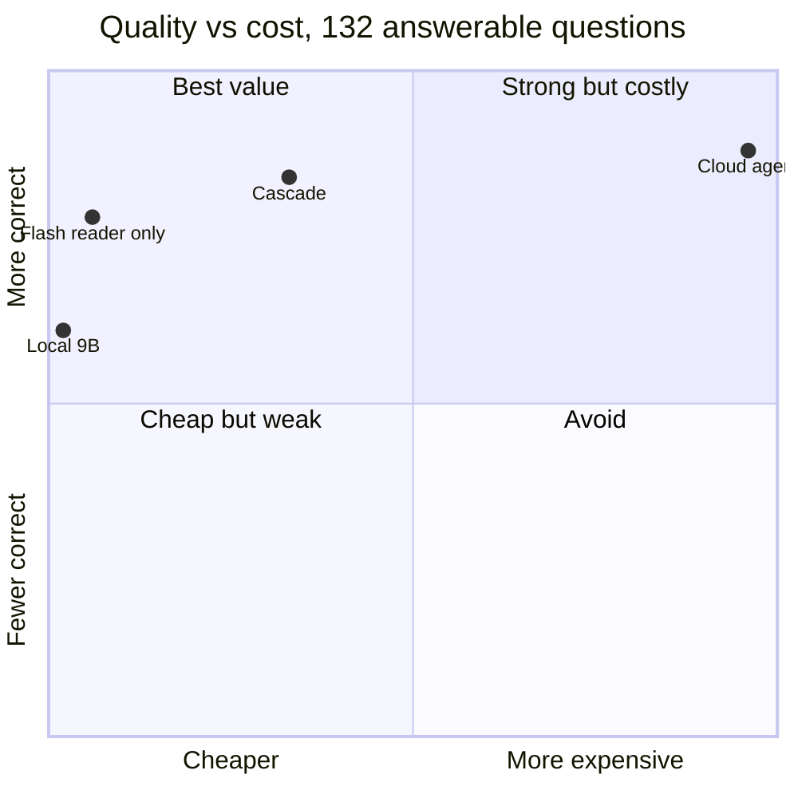
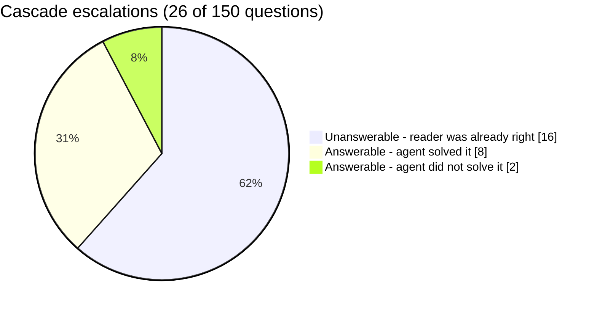

# 08 — Local, cloud and cascade

[← 07 — Frontier ceiling](07-frontier-ceiling.md) · [README](README.md) · Next: [09 — Discussion and current state →](09-discussion-and-current-state.md)

*Date: 22 October 2026. Where: **everything on the VM** (09:13–15:00 UTC), production Node runtime, benchmark release prepared without activation and verified with the full test suite. 450 answers, two judges each (agreement 447/450, 3 tie-breaks). Cloud use approved for operations as well as benchmarking.*

## 8.1 The question

Three candidate architectures, compared on quality **and** cost. The goal was stated before the runs: the combined solution should have the best quality-to-price ratio. If it did not, the architecture would be reconsidered.

## 8.2 Choosing the cascade from data we already had

Before running anything new, we simulated cascades offline on the records of 16 and 19 October (88 answerable questions):

| Simulated cascade | Correct (of 88) | Approx. USD / 100 questions |
| --- | --- | --- |
| 9B reader first, cloud only if the 9B abstains | 56–58 | low |
| Cloud reader on locally retrieved passages | 65 | ~0.32 |
| **Cloud reader on local passages, cloud agent if the reader abstains** | **72** | **~0.77** |
| Cloud agent on everything | 78 | ~5.3 |

**"Local first, escalate when unsure" does not work with a small model that is wrong without knowing it.** The 9B abstained on only 4 of its 34 errors. Its citations always resolved, and the reranker score was the same for its right and wrong answers. None of these signals separates its right answers from its wrong ones. The cloud reader, by contrast, abstains when the passages are insufficient, and its abstention is a usable escalation signal.

Because the cascade rule was chosen on these two sets, **the decision had to be taken on a new holdout**. Holdout 2 was written by an isolated agent with the list of the 100 existing questions to avoid. Its essential facts were annotated blind before any run (165/168 agreement).

## 8.3 The three configurations

The escalation signal is the reader's **outcome** (abstention, format failure, error), not a self-reported confidence score ([code](code/cascade.ts)). Cost and latency of both stages are summed per question.

## 8.4 Decisive result: holdout 2 (44 answerable, 6 unanswerable)

| Configuration | Correct | 95% CI | Supporting citations | Correct abstentions | False claims (both judges) | p50 / p95 | USD / 100 questions |
| --- | --- | --- | --- | --- | --- | --- | --- |
| L, local only | 28/44 (64%) | 49–76% | 84% | 6/6 | 7 | 3.2 / 5.8 s | 0 |
| **M, cascade** | **40/44 (91%)** | 79–96% | **87%** | 6/6 | **0** | 6.8 / 144.2 s | **2.14** |
| C, cloud only | 39/44 (89%) | 76–95% | 83% | 6/6 | 3 | 23.8 / 103.4 s | 5.39 |

By category (L / M / C): direct 10, 12, 12 of 12; synonyms 7, 9, 10 of 10; multi-hop 7, 9, 7 of 10; contradictions 1, 4, 3 of 4; obsolete 3, 4, 4 of 4; source detail 0, 2, 3 of 4.

**Decision rule** (fixed in advance, [02](02-methodology.md#25-decision-rules-fixed-before-the-runs)):

| Criterion | Value | Outcome |
| --- | --- | --- |
| 1. M better than L (exact McNemar) | only M 12, only L 0, **p = 0.0005** | ✔ |
| 2. Cost per extra correct answer over L | M: $1.07 / 12 = **$0.089**; C: $2.70 / 11 = $0.245 | ✔ |
| Price of C's extra answers over M | C is not better than M (39 vs 40; only C 3, only M 4) | — |

With the 2027 price list (doubled) the costs become $0.18 and $0.49 per gained answer; the ratio between the two does not change. Removing the 3 questions the holdout author flagged as close to existing ones leaves L 26, M 37, C 36 of 41, p = 0.001, and the rule still holds.

**The rule is satisfied: the cascade has the best quality-to-price ratio.**

## 8.5 Continuity: the two known sets (88 answerable)

| Configuration | F1 | Holdout 1 | Together | Supporting citations (F1 / H1) | USD / 100 | p50 (F1 / H1) |
| --- | --- | --- | --- | --- | --- | --- |
| L | 25/44 | 28/44 | 53/88 (60%) | 82% / 76% | 0 | 3.3 / 3.3 s |
| M | 33/44 | 38/44 | 71/88 (81%) | **90% / 86%** | 1.89 | 4.7 / 5.1 s |
| C | **37/44** | **40/44** | **77/88 (88%)** | 76% / 84% | 5.98 | 35.8 / 24.6 s |

M vs L: 20 to 2 (p = 0.0001). C vs M: 13 to 7 (**p = 0.26**, not significant). Climbing from M to C costs **$0.68 per extra correct answer** ($1.36 from 2027). Where C beats M: **source detail 8/8 vs 2/8** and multi-hop 15/20 vs 13/20. M leads on contradictions (7/8 vs 4/8).

The earlier results replicated: Flash agent 78/88 on 19 Oct and 77/88 on 22 Oct; Flash reader on the evidence 65/88 and 66/88 (as M's first stage); 9B on the evidence 54/88 and 53/88.

## 8.6 All three sets (132 answerable)

| Configuration | Correct | Total cost (150 questions) | USD / 100 questions (2026 / 2027) | USD per correct answer |
| --- | --- | --- | --- | --- |
| L | 81 (61%) | $0 | 0 / 0 | 0 |
| **M** | **111 (84%)** | $2.96 | 1.98 / 3.95 | **0.027** |
| C | 116 (88%) | $8.67 | 5.78 / 11.57 | 0.075 |

*x = USD per 100 questions on a 0–6 scale (local $0, reader only $0.32, cascade $1.98, cloud $5.78); y = share of the 132 answerable questions answered correctly.*

Two derived configurations, computed from the same records and not decisive:

- **Flash reader only** (M's first stage, no agent): 103/132 for $0.32 per 100 questions. It is the cheapest per gained answer ($0.022), with 8 fewer answers than M.
- **9B first, then M if the 9B abstains**: 84/132, only 3 more than L, as the simulation had predicted, because the 9B is wrong without abstaining.

## 8.7 Where the cascade's money goes

| Stage | Calls | Cost (150 questions) | Share |
| --- | --- | --- | --- |
| Flash reader on local passages (always) | 150 | $0.49 | 16% |
| Flash agent (26 of 150 questions, all because the reader abstained) | 321 | $2.48 | **84%** |

Of the 26 escalations, **16 were on unanswerable questions**. The reader had already abstained correctly, and the agent almost always confirmed the abstention (17/18 correct abstentions for M across the three sets). The other 10 were answerable, and the agent solved 8 of them. The high p95 of M (83–144 s) comes from these escalations and from provider congestion. The median stays at 4.7–6.8 s, against 24–36 s for C.

## 8.8 Provider errors

Between 09:20 and 14:45 UTC the provider's global endpoint held many requests in queue for minutes, with some 429s from a quota shared with another project. Each attempt is cancelled after 30 s and retried up to 4 times. After the fourth, the question ends as `llm-error` or `time-budget`. As fixed in the protocol, these records are not model outcomes: they were removed (originals kept in a backup) and the questions re-run in the same run. 4 questions of C and 18 of M on holdout 2, 2 of M and 17 of C on F1, 9 of M on holdout 1 were re-run. After the first round of retries all 450 answers arrived. **No question was counted as wrong because of a provider error.**

## 8.9 Reading

1. **The cascade has the best quality-to-price ratio**, by the rule fixed before the runs. On the fresh holdout it matches the cloud agent (40 vs 39) at about 40% of the cost, and across all sets the cost per gained answer is about 40% of the cloud's.
2. **The cloud agent remains stronger where original sources are needed.** On the known sets it leads by 6 of 88, almost all source detail. The difference is not significant, and it costs $0.68 per answer.
3. **The cascade has the best citations (86–90%) and almost no false claims** (2 of 150, against 20 for the 9B and 5 for the cloud agent). The 95% gate is still not met, because the escalation agent's broader citations pull down the reader's 95–97%.
4. **The escalation agent is the main cost and often fires for nothing.** 62% of escalations were on unanswerable questions. A more selective criterion (for instance, escalate only when the reader reports *partial* evidence) could bring the cost close to the reader-only figure. That has to be measured on new questions.

## 8.10 Limits

- **Cost of cancelled requests is unknown.** A request cancelled at 30 s may still have been processed and billed. Retried attempts within counted answers were 49 for M and 57 for C. At average cost per call the maximum extra is about $0.3 for M and $0.4 for C over the three sets, which does not change the ranking.
- **Latencies of C and M are inflated by the congestion of that day.** Successful calls had a median of 2–3 s but a tail up to 29 s. The 30 s cap may also have cancelled slow but valid requests. The p95 is not representative of operation; the p50 is, with caution.
- The cascade rule was chosen on F1 and holdout 1, which is why holdout 2 decides.
- 44 answerable questions decide. The intervals of M and C almost entirely overlap, so the rule compares M with L and with cost, not M with C.
- Local marginal cost is set to zero: the VM is already paid for, and energy and occupancy of the shared vGPU are not estimated.

[← 07 — Frontier ceiling](07-frontier-ceiling.md) · [README](README.md) · Next: [09 — Discussion and current state →](09-discussion-and-current-state.md)
