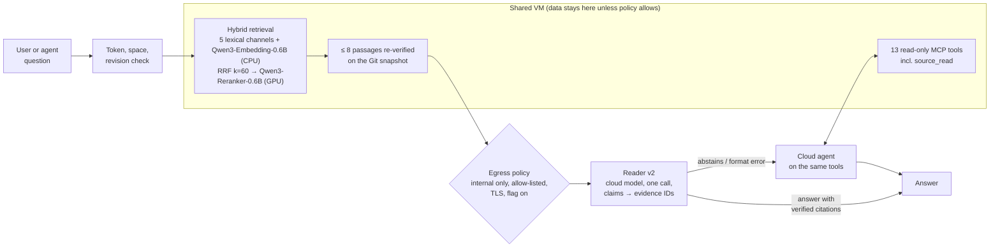

# 09 — Discussion, threats to validity and current state

[← 08 — Local, cloud and cascade](08-hybrid-cascade.md) · [README](README.md)

## 9.1 Where we are (as of 14 November 2026)

The last experiment ran on 22 October. No new measurement has been taken since; this page is the consolidated state.

### Best measured configurations

| Use | Configuration | Measured quality | Cost and resources |
| --- | --- | --- | --- |
| **Recommended operating profile** | **Cascade**: B4 retrieval on the VM → reader v2 on Gemini Flash → Flash agent only if the reader abstains | Holdout 2: **40/44 (91%)**; all sets 111/132 (84%); citations 86–90%; 2 false claims in 150 | $1.98–2.14 per 100 questions (2026 list price); p50 4.7–6.8 s |
| Best fully local | B4 retrieval → reader v2 on **Qwen3.5-9B IQ4_XS** | 54/88 (61%) and 28/44 on holdout 2; citations 80–84% | Zero marginal cost; 9B and reranker do not fit together within the agreed margin |
| Local, interactive-friendly | B4 retrieval → reader v2 on Qwen3.5-4B Q4_K_M | 46/88 (52%); citations 78% | 4B + reranker co-resident in GPU, ~1.2 GiB free; p50 ~2.7 s |
| Quality ceiling | Gemini Flash tool-calling agent | 77–78/88 (88–89%); 39/44 on holdout 2; citations 76–84% | ~$5.4–6.0 per 100 questions; p50 24–36 s |

### The architecture that came out of the research

### Against the original gates

| Gate | Best fully local | Cascade | Cloud agent |
| --- | --- | --- | --- |
| ≥ 90% correct (fresh holdout) | 64% ✗ | **91% ✔** (CI 79–96%) | 89% ✗ (borderline) |
| ≥ 90% correct (known sets, 88) | 60% ✗ | 81% ✗ | 88% ✗ |
| ≥ 95% supporting citations | 80–84% ✗ | 86–90% ✗ | 76–84% ✗ |
| Correct abstention | 6/6 ✔ | 6/6 ✔ | 6/6 ✔ |

The cascade reached the correctness gate on the one set that was decisive, but not on the pooled known sets. No configuration reached the citation gate together with the correctness gate. The evidence engine with a frontier reader alone reaches 95–96% citations at 74–75% correctness ([07](07-frontier-ceiling.md)).

## 9.2 What we believe, and how strongly

**Strong evidence** (replicated, significant, on sets the developers did not write):

1. *A benchmark curated by the builders of the retrieval overestimates it dramatically* (98% vs 27% on the same engine and criterion).
2. *On this hardware the reader, not retrieval, limits the final system once hybrid retrieval with a reranker is in place.* Retrieval delivered 98% of expected pages on holdout 1. Frontier readers on identical passages gained 11–12 answers out of 88 over the 9B, and the 4B oracle had a ceiling of 73–82%.
3. *Model size helps small models as readers and not as agents.* 9B vs 4B: +8 as reader (p = 0.039), −3 as agent (p = 0.66).
4. *The semantic channel is the largest single generation gain over permissive lexical retrieval* (+11 net, p = 0.001), and *the reranker adds a significant further gain on the VM* (+8 net, p = 0.039).
5. *Citation quality is a property of the engine more than of the model.* Verified passages with evidence IDs gave 94–97% support with frontier readers, against 78–87% for the same models as agents.
6. *A local-first cascade with a small local model fails because the small model is wrong without knowing it* (abstained on 4 of 34 errors).
7. *A cloud reader over locally retrieved passages, escalating to a cloud agent on abstention, matched the cloud agent on a fresh holdout at ~40% of the cost.*

**Weaker evidence** (plausible, not significant, or single-run):

- The cloud agent is better than the cascade on source-detail questions (8/8 vs 2/8 on the known sets), but the overall difference is not significant (p = 0.26).
- A more selective escalation rule would cut the cascade's cost substantially (62% of escalations are on questions the reader had already handled correctly). This is an inference, not yet measured.
- Linked original sources (B5) could fix source-detail questions for a capable reader. With the 4B they helped that category and hurt others.

## 9.3 Threats to validity

| Threat | Effect | Mitigation used | Residual risk |
| --- | --- | --- | --- |
| **LLM judges, not humans** | Systematic leniency or bias | Blind packages, rubric written before answers, essential facts annotated blind, two judges + tie-break, 98–99% agreement | Judges share a model family; a human panel might draw the line elsewhere |
| **Judges launched by the developing agent** | Subtle steering | Rubric versioned in advance; judges see no system identity; reshuffled batches | Not eliminated |
| **Question writers are LLM agents** | Questions may be "LLM-shaped" | Isolation from code, sets and reports; overlaps flagged before runs | Real user questions may differ in length, ambiguity and language mix |
| **Small sets (44 answerable)** | Wide intervals | Wilson CIs, paired McNemar, decisions on fresh holdouts only | Differences < ~5 answers are not resolvable |
| **One corpus, one language** | Limited external validity | — | Absolute numbers will not transfer |
| **Cross-platform retrieval drift** | Laptop vs VM bundles differ | Final decisions measured on the VM | 19 Oct frontier runs used laptop retrieval (Jaccard 0.90 vs VM) |
| **Provider congestion on 22 Oct** | Inflated latency, possible hidden cost | Pre-registered retry and exclusion rule, cost upper bound | p95 latencies for cloud configurations are not representative |
| **Introductory cloud pricing** | Cost conclusions may shift | Both 2026 and 2027 prices reported | Ratios hold; absolute values will change |
| **Thinking tokens** | Under-counted cost on 19 Oct | Recorded from 22 Oct onward | 19 Oct cost figures are lower bounds |

## 9.4 Lessons for building on small, shared hardware

1. **Write the benchmark last, or have someone else write it.** Better still, keep a holdout nobody has seen and use it only to decide.
2. **Separate retrieval from reading with an oracle before changing models.** It tells you which half to fix.
3. **Fix the architecture before comparing models.** The conclusion "the bigger model doesn't help" was true for the agent and false for the reader.
4. **Measure the judge.** The first rubric's ambiguity changed which variant looked best. Two judges and blind essential-fact annotation made the measurement reproducible.
5. **Design tools for the weakest model.** Opaque cursors gave a 25% tool-error rate with small models, and short aliases removed it.
6. **On a shared host, budget host commit and VRAM together.** The default prompt cache of the inference runner almost exhausted the machine's commit charge in a minute.
7. **A 0.6B reranker belongs on the GPU.** On a shared 10-core CPU it took 69 s per question; on the GPU, 1 s.
8. **Escalate on outcomes, not on confidence.** The small model's errors were silent. The cloud reader's abstention was a signal we could act on.
9. **Pre-register the decision rule**, including what counts as a provider error. It took the argument out of the decision.
10. **Endpoint protection is a design constraint.** The runtime choice was decided by a code signature.

## 9.5 Open decisions and next steps

In priority order:

1. **Cascade as the router's operating profile.** Measure a more selective escalation criterion (escalate on *partial* evidence rather than on any abstention), and targeted opening of original sources for source-detail questions, on new questions. Then decide the operating profile.
2. **Local reader profile and the vGPU.** The 9B reader is the best local option but does not fit with the reranker within the 1,024 MiB margin. Options: a lower margin (affects the shared desktop sessions), more VRAM, a smaller or CPU reranker (latency), or per-question model swaps (latency to be measured interactively).
3. **Reader quality on contradictions and source-only details.** Contradictions reached only 1/4 even with the oracle passages and the 4B, and source detail is 0/4 for the evidence engine. Activate linked sources only for detail questions, and measure on a new holdout.
4. **Router and context tests**: implement the router with the chosen profile, and test 24k–32k contexts within the VRAM margin.
5. **Close the citation gap**: bring reader-v2-style evidence citations into the agent, or targeted source opening into the evidence engine. These are the two paths towards meeting both gates with one configuration.
6. **Runtime for a pilot.** Today one model serves one request at a time. Using `llama-server` directly would give parallel slots and native batched reranking, but the upstream binary is blocked. This needs an IT decision, including on the signed `llama-server` bundled with Ollama.

## 9.6 Timeline of the research

| Date | Step | Where | Key number |
| --- | --- | --- | --- |
| 28–30 Sep | Specification v1.1: hybrid retrieval without embeddings, rebuildable SQLite index, model router | — | — |
| 8 Oct | Target fixed on the shared VM; Git snapshot → SQLite → MCP | VM | — |
| 9–12 Oct | First real corpus: 711 sources, 83 compiled pages, 997 citations | Laptop, VM | — |
| 12–13 Oct | F0 closed: lexical benchmark on developer-written set | VM | 49/50 (98%) |
| 13 Oct | Independent set exposes lexical retrieval | Laptop | **12/44 (27%)** |
| 13 Oct | llama.cpp blocked; Ollama signed portable; four models, 1,200 runs | VM | 4B agent 43% |
| 15 Oct | Retrieval ablations M0–M6, oracle | Laptop | B4 26/44 (prov.), oracle 36/44 |
| 15–16 Oct | Pipeline on VM; reranker CPU vs GPU; RAM commit trap | VM | 69 s → 1 s reranking |
| 16 Oct | Judging v2; holdout 1; reader v2; 9B as reader | VM | **54/88**, 9B > 4B p = 0.039 |
| 19 Oct | Frontier ceiling (Gemini Flash / Pro) | Laptop → cloud | Flash agent 78/88; evidence 96% citations |
| 22 Oct | Local vs cloud vs cascade, holdout 2, pre-registered rule | VM | **Cascade 40/44 at $2.14 / 100** |

[← 08 — Local, cloud and cascade](08-hybrid-cascade.md) · [README](README.md)
