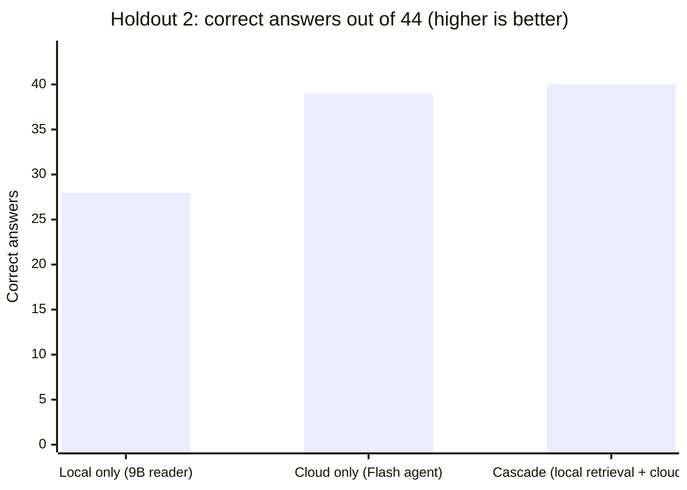
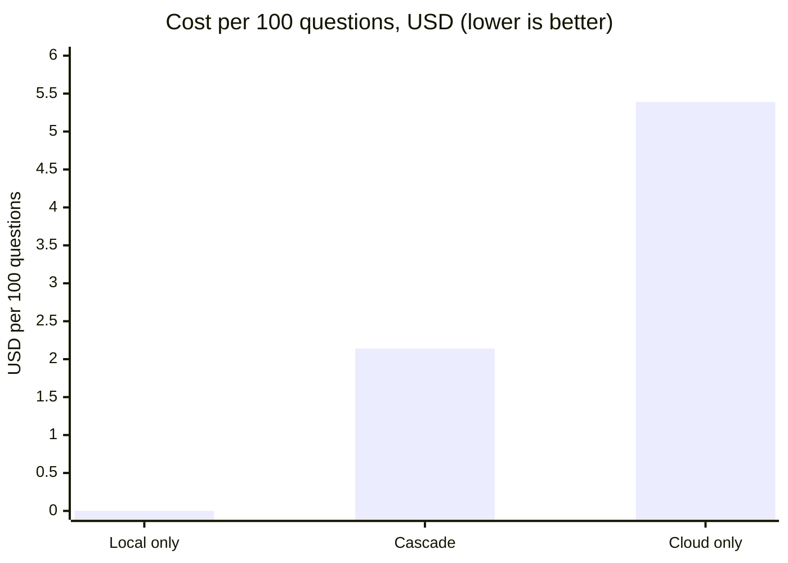
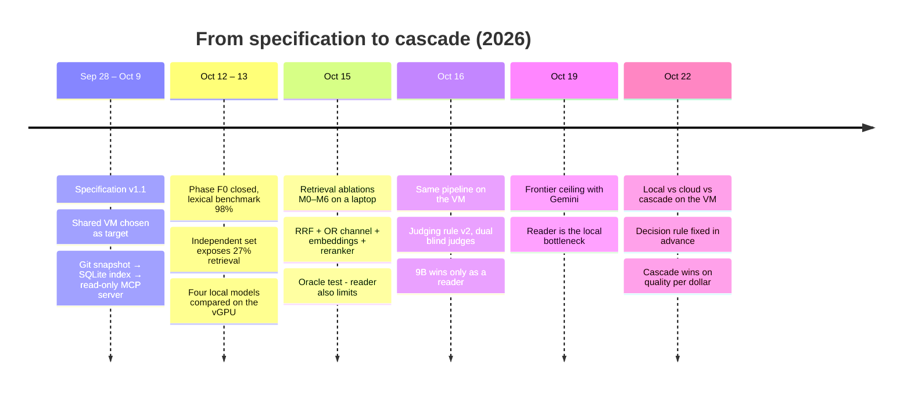
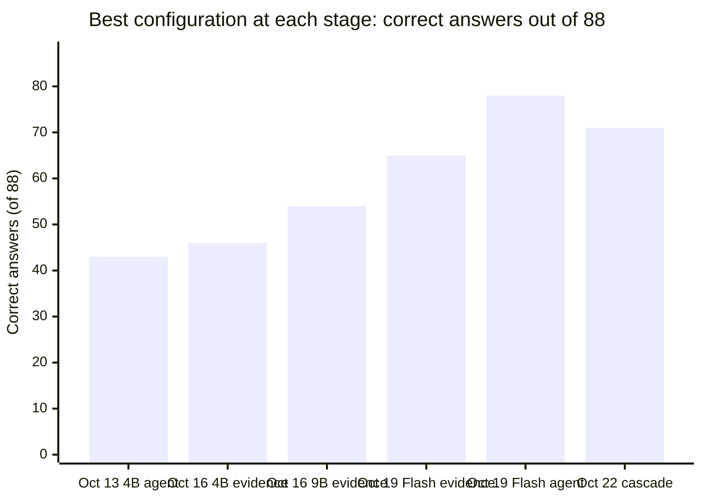

# Grounded Answers on an 8 GB Shared GPU

**An empirical search for a retrieval-and-reader architecture that answers questions over a company knowledge wiki, with verified citations, on a resource-constrained shared virtual machine.**

*Research log, 28 September – 22 October 2026. Status as of 14 November 2026.*

---

## Abstract

We set out to build an internal "second brain": a Markdown wiki compiled from project documentation, versioned in Git, and queried by language-model agents that must answer **with verifiable citations** and **abstain** when the corpus does not contain the answer. The production target was not a GPU server but a shared Windows virtual machine: 10 vCPUs, 32 GB of RAM shared with another team's always-on services, and an **8 GiB NVIDIA vGPU slice of which about 1.8 GiB is already taken by desktop sessions**. Corporate endpoint protection blocked unsigned inference binaries, the machine could never be rebooted, and every GPU experiment had to run inside an agreed window.

Over four weeks we collected about 3,400 judged answers across four question sets, four local models, a dozen retrieval variants, two frontier models and a local–cloud cascade. Four findings shaped the outcome:

1. **A benchmark written by the people who built the search engine measures the vocabulary of the search engine.** Our first lexical benchmark scored 98%; an independently written question set scored **27%** on the same retrieval.
2. **Bigger local models did not help inside an agent loop.** Qwen3.5-9B was no better than Qwen3.5-4B as a tool-calling agent (40 vs 43 of 88 correct). It became significantly better only once the system stopped asking the model to *search* and asked it only to *read* (54 vs 46, p = 0.039).
3. **Deterministic retrieval with fusion, a small embedding model and a small reranker** (BM25 channels + Qwen3-Embedding-0.6B + Qwen3-Reranker-0.6B, fused with RRF) delivered 98% of the expected pages to the reader on a fresh holdout at ~1 s of GPU cost. After that, the bottleneck was the reader, not retrieval.
4. **The best quality-per-cost configuration is hybrid.** Retrieval stays on the VM, a cloud model reads only the ~3k tokens of verified local evidence, and a cloud agent is called only when that reader abstains. On a holdout fixed before the runs, this cascade answered **40/44 (91%)** correctly, against 28/44 for the best fully local setup and 39/44 for a fully cloud agent, at **$2.14 per 100 questions versus $5.39**.

Neither the local-only nor any single configuration reached both quality gates we set (≥ 90% correct answers *and* ≥ 95% supporting citations). The documents below explain how we got there, what we measured, what we got wrong along the way, and what remains open.

---

## Headline result

Correct answers on the decisive holdout (44 answerable questions, written by an isolated agent after the cascade rule was fixed, judged blind by two judges):





| Configuration | Correct (holdout 2) | Supporting citations | False claims | Median latency | USD / 100 questions |
| --- | --- | --- | --- | --- | --- |
| Local only: hybrid retrieval + Qwen3.5-9B reader | 28/44 (64%) | 84% | 7 | 3.2 s | 0 (marginal) |
| **Cascade: local retrieval → Gemini Flash reader → Flash agent on abstention** | **40/44 (91%)** | **87%** | **0** | 6.8 s | **2.14** |
| Cloud only: Gemini Flash tool-calling agent | 39/44 (89%) | 83% | 3 | 23.8 s | 5.39 |

Full numbers and caveats: [08 — Local, cloud and cascade](08-hybrid-cascade.md).

---

## The research path at a glance



Correct answers on the 88 answerable questions of the two older sets (independent set + holdout 1), for the configuration that was best at each stage:



*The Oct 13 figure is the 4B agent re-run on the VM with the Oct 16 harness and judging rule, so the columns are comparable. On these two sets the cloud agent stays ahead of the cascade (77–78 vs 71, p = 0.26). The cascade wins on cost per correct answer, and on the fresh holdout 2 it matches the agent.*

---

## Contents

| # | Document | What it covers |
| --- | --- | --- |
| 01 | [Problem, system and constraints](01-problem-and-constraints.md) | What we built, the shared VM, the memory budget, the non-negotiable operating rules |
| 02 | [Methodology](02-methodology.md) | Question sets, categories, blind dual judging, statistics, decision rules fixed before runs, GPU windows |
| 03 | [Phase F0: the lexical baseline and the 98% illusion](03-lexical-baseline.md) | BM25 over a Git-versioned wiki, and why the first benchmark misled us |
| 04 | [Choosing a local model for an 8 GiB vGPU](04-local-model-selection.md) | Runtime blocked by endpoint protection, four candidates, 1,200 judged runs |
| 05 | [Retrieval ablations: from agent to evidence engine](05-retrieval-ablations.md) | RRF, an OR channel, embeddings, a reranker, linked sources, graph expansion, the oracle |
| 06 | [Validation on the VM, a better judge and a better reader](06-vm-validation.md) | Reranker CPU vs GPU, the RAM commit trap, judging rule v2, holdout 1, the 9B as reader |
| 07 | [The frontier ceiling](07-frontier-ceiling.md) | Gemini Flash and Pro on the same harness: where the local system loses |
| 08 | [Local, cloud and cascade](08-hybrid-cascade.md) | The decisive experiment, cost model and decision rule |
| 09 | [Discussion, threats to validity and current state](09-discussion-and-current-state.md) | What we believe, what we do not, and what is next |
| A | [Judge instructions v2](appendix-a-judge-instructions.md) | The exact rubric used for every judged answer since 16 October |
| B | [Glossary](appendix-b-glossary.md) | Terms used across the documents |
| — | [code/](code/README.md) | Annotated excerpts of the components that mattered |
| — | [data/](data/README.md) | The result tables behind every chart, as CSV |

## How to read this

If you have ten minutes, read this page, then [08](08-hybrid-cascade.md) and [09](09-discussion-and-current-state.md). If you are building something similar on small hardware, read [05](05-retrieval-ablations.md) and [06](06-vm-validation.md): they contain the ablations and the operational traps. If you want to reuse the evaluation protocol, read [02](02-methodology.md) and [Appendix A](appendix-a-judge-instructions.md).

## Scope and honesty notes

- **Judging was delegated to language models, not humans.** Every correctness and citation verdict comes from blind Claude judges working from a written rubric, two per answer, with a third on disagreements. Agreement was 98–99%, but this is not human review and we do not present it as such.
- **Small samples.** Each set has 44 answerable questions, so one question is worth 2.3 percentage points. We report Wilson 95% intervals and exact McNemar tests on paired answers, and we call differences "significant" only at p < 0.05.
- **One corpus.** 83 compiled wiki pages over 711 source documents from about nine projects, mostly in Italian. The findings about *relative* behaviour are likely to transfer; the absolute percentages are not.
- **Internal identifiers removed.** Host names, project names, cloud project IDs, colleagues' names and corpus content have been removed or generalised. Questions from the benchmark sets are not reproduced, because they quote internal documentation.
- **Model names and prices are those of October 2026.** The cloud prices are introductory list prices that double from 1 January 2027; we show both where it matters.

## Citation

If you reference this work:

```
Grounded Answers on an 8 GB Shared GPU: an empirical search for a retrieval-and-reader
architecture for a company knowledge wiki on a resource-constrained shared VM.
Research log, October 2026.
```
